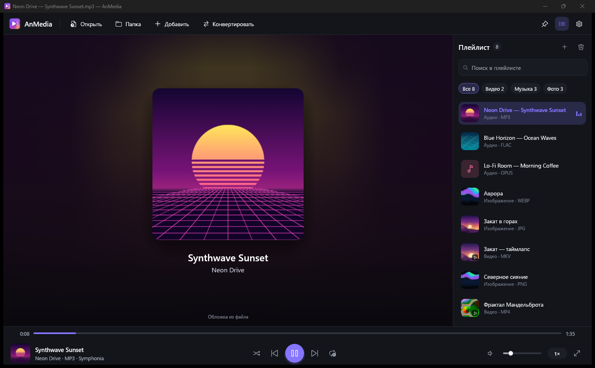
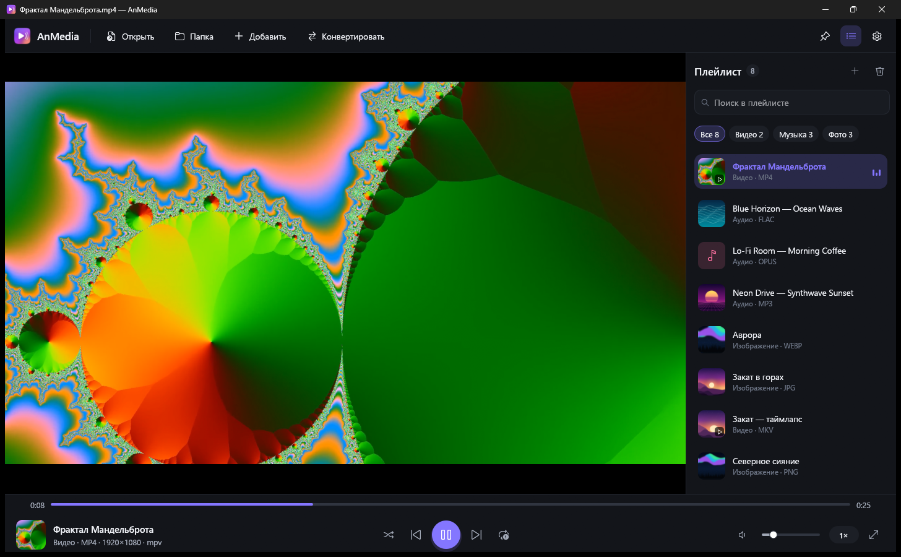
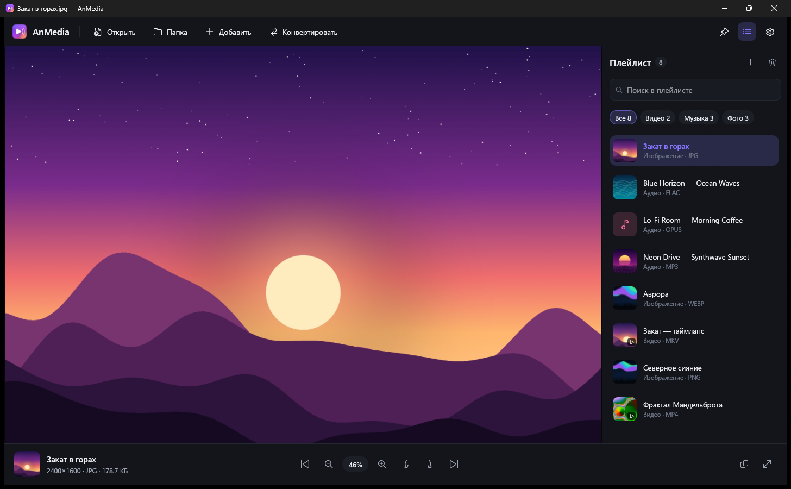
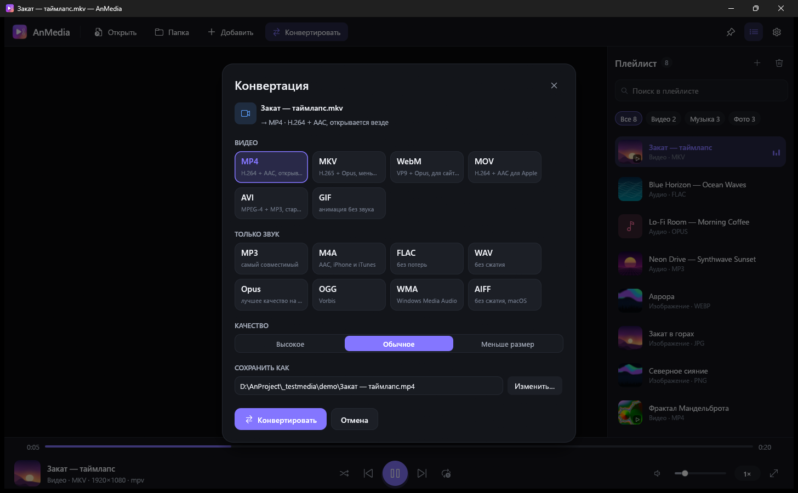
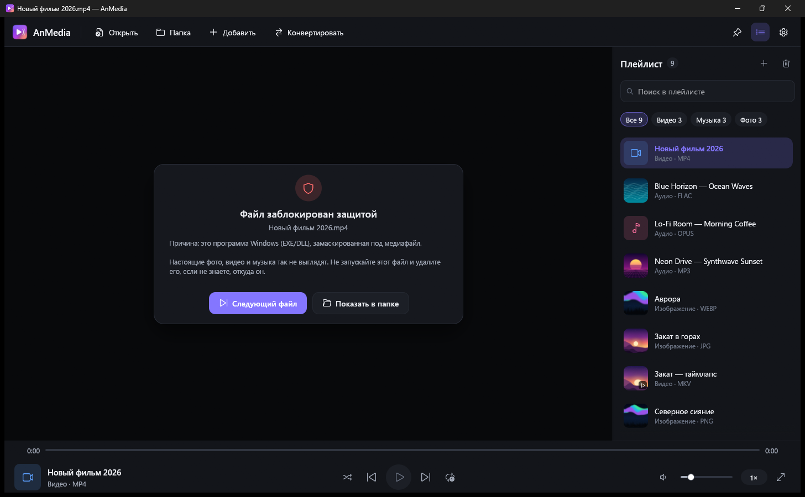
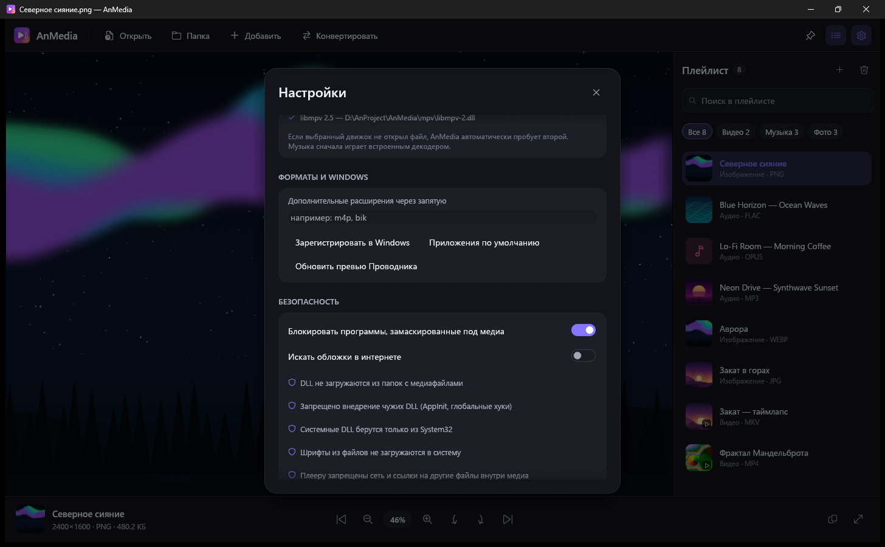
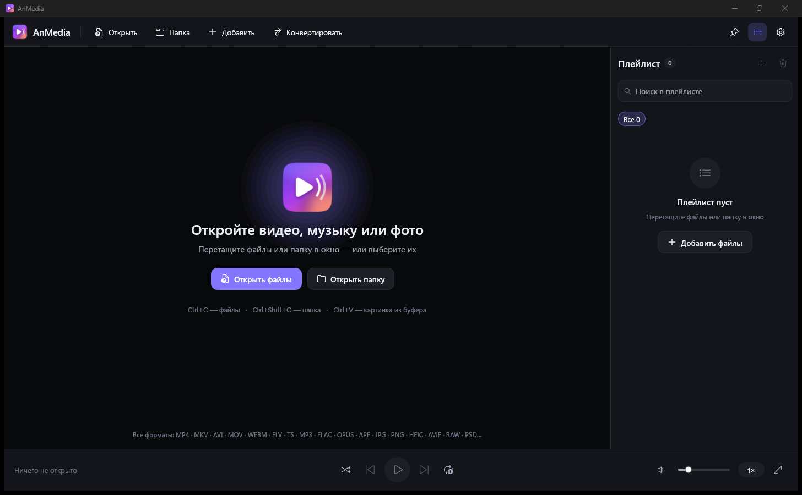

<div align="center">


# AnMedia

**Быстрый медиаплеер для Windows: видео, музыка и фото в одном окне**

Открывает практически любой формат, конвертирует файлы и защищает систему от вредоносных «медиафайлов».




</div>

---

## Возможности

- 🎬 **Любое видео** — MP4, MKV, AVI, MOV, WebM, FLV, TS, WMV, RM/RMVB, ProRes, HEVC, AV1, VP9 и десятки других через встроенный движок **libmpv (FFmpeg)**. Субтитры рядом с видео подхватываются сами.
- 🎵 **Любая музыка** — MP3, FLAC, Opus, OGG, AAC/M4A, ALAC, WMA, WAV, APE, WavPack, TTA, AC3/DTS, AMR, трекерная музыка. Обложки из тегов или из интернета, фон окна окрашивается под обложку.
- 🖼️ **Любые фото** — JPEG, PNG, WebP, HEIC, AVIF, JPEG XL, RAW камер (CR2/CR3, NEF, ARW, DNG…), PSD, SVG, TIFF, EXR, HDR и другие. Анимированные GIF / WebP / APNG, учёт EXIF-поворота, огромные снимки.
- 🔍 **Формат по содержимому** — файлы без расширения или с неправильным расширением всё равно открываются.
- 🔄 **Конвертер** — видео, музыку и фото в другой формат в пару кликов, с выбором качества и прогрессом.
- 🔎 **Масштаб как в просмотрщике фото** — колесо мыши приближает к курсору, перетаскивание двигает кадр, и для видео тоже.
- 🛡️ **Защита** — программы, ярлыки и скрипты, замаскированные под видео/фото/музыку, не открываются; плеер работает в «песочнице» из ограничений Windows.
- 🎨 **Современный интерфейс** — тёмная и светлая темы, 6 акцентных цветов, плейлист с миниатюрами, фильтры, поиск, полноэкранный режим с автоскрытием панели.
- ⚡ **Лёгкий и быстрый** — нативное приложение на Rust, один экземпляр, запоминание плейлиста и позиции.

## Скриншоты

| Видео | Фото |
|:---:|:---:|
|  |  |
| **Конвертер** | **Защита от замаскированных файлов** |
|  |  |
| **Настройки** | **Стартовый экран** |
|  |  |

## Установка

Скачайте последнюю версию в разделе [**Releases**](../../releases):

| Файл | Что это |
|---|---|
| **`AnMedia-2.0.0-Setup.exe`** | Установщик — рекомендуется |
| `AnMedia-2.0-Windows-x64.zip` | Портативная версия без установки |

Требования: Windows 10 / 11 x64. Права администратора не нужны.

### Установщик

1. Запустите `AnMedia-2.0.0-Setup.exe`.
   Если Windows SmartScreen покажет «Неизвестный издатель» — нажмите **«Подробнее» → «Выполнить в любом случае»** (файл не подписан платным сертификатом).
2. Выберите дополнительные задачи:
   - **ярлык на рабочем столе**;
   - **«Открыть с помощью»** — AnMedia появится в меню правого клика для фото, видео и музыки.
3. Готово: AnMedia появится в меню «Пуск».

Чтобы открывать файлы двойным щелчком, выберите AnMedia в **Параметры Windows → Приложения → Приложения по умолчанию** (кнопка есть и в настройках самой программы).

| | |
|---|---|
| **Куда ставится** | `%LOCALAPPDATA%\Anton4k272\AnMedia\data` (только для текущего пользователя) |
| **Обновление** | Просто запустите установщик новой версии поверх старой — запущенный AnMedia закроется сам, настройки и плейлист сохранятся |
| **Удаление** | Параметры → Приложения → Установленные приложения → AnMedia → «Удалить». Удаляются программа, кэш и все записи в реестре; настройки (`%APPDATA%\Anton4k272\AnMedia`) остаются |
| **Тихая установка** | `AnMedia-2.0.0-Setup.exe /VERYSILENT /TASKS="associate,desktopicon"` |

### Портативная версия

Распакуйте `AnMedia-2.0-Windows-x64.zip` в любую папку и запустите `AnMedia.exe`. `AnMedia.exe` и `libmpv-2.dll` должны лежать рядом — без DLL плеер тоже работает, но только с кодеками, установленными в Windows.

При запуске портативная версия регистрирует себя в «Открыть с помощью» и копирует себя в ту же папку, что и установщик, — так ассоциации не сломаются, если распакованную папку удалить. Убрать её из системы можно командой `AnMedia.exe --unregister`.

## Конвертер

Кнопка **«Конвертировать»**, `Ctrl+E` или правый клик по файлу в плейлисте.

| Из | В |
|---|---|
| Видео | MP4 (H.264), MKV (H.265), WebM (VP9), MOV, AVI, GIF — или только звук |
| Музыка | MP3, M4A (AAC), FLAC, WAV, Opus, OGG, WMA, AIFF |
| Фото | PNG, JPG, WebP, AVIF, BMP, TIFF, ICO, GIF, TGA, QOI |

Три уровня качества, отмена в любой момент, исходный файл никогда не перезаписывается.

## Безопасность

Сам по себе медиафайл не может «запуститься», но злоумышленники маскируют программы под видео и пользуются ошибками в декодерах. AnMedia защищается от этого:

- **Проверка содержимого.** EXE/DLL, ярлыки LNK, установщики MSI, HTML/HTA и скрипты, переименованные в `.mp4`/`.jpg`/`.mp3`, блокируются. Ловится и подмена расширения невидимыми символами (`фото‮gpj.exe`).
- **Ограничения процесса Windows.** DLL не подгружаются из папки с медиафайлом (защита от DLL-подмены), запрещено внедрение чужих DLL и загрузка несистемных шрифтов.
- **Изолированный движок.** mpv читает только сам файл: без сети, без ссылок на другие файлы и плейлистов внутри медиа, без скриптов и конфигов.
- **Безопасные декодеры.** SVG не может читать файлы с диска, у изображений есть лимиты памяти против «бомб».
- Файлы, скачанные из интернета (Mark of the Web), помечаются уведомлением. Поиск обложек в сети можно отключить.

> Это не антивирус: защита закрывает типичные способы атаки через медиафайлы, но не заменяет антивирусную проверку.

## Горячие клавиши

| Клавиша | Действие |
|---|---|
| `Ctrl+O` / `Ctrl+Shift+O` | Открыть файлы / папку |
| `Ctrl+V` / `Ctrl+C` | Открыть картинку из буфера / скопировать фото |
| `Ctrl+E` | Конвертировать |
| `Пробел` / `S` | Пауза / стоп |
| `←` `→` | Перемотка 5 с (`Ctrl` — 30 с); для фото — предыдущее/следующее |
| `PgUp` / `PgDn` | Предыдущий / следующий файл |
| `↑` `↓` / `M` | Громкость / без звука |
| `[` `]` | Скорость воспроизведения |
| Колесо, `+` `−`, `0` | Масштаб, сброс масштаба |
| `1`, `R` / `Shift+R` | Фото: 100%, поворот |
| `F11`, `F`, двойной щелчок | Полный экран |

## Сборка из исходников

Требования: Windows 10/11 x64, [Rust](https://rustup.rs) (версия подтянется из `rust-toolchain.toml`), Visual Studio Build Tools с MSVC и Windows SDK.

```powershell
git clone https://github.com/<user>/AnMedia.git
cd AnMedia
.\build.bat                        # → dist\AnMedia-2.0-Windows-x64.zip
.\scripts\build-installer.ps1      # → dist\AnMedia-2.0.0-Setup.exe + zip
```

| Скрипт | Что делает |
|---|---|
| `build.bat` / `scripts\build-release.ps1` | Release-сборка и портативный zip. Если `libmpv-2.dll` нет — скачивает её |
| `scripts\build-installer.ps1` | Всё то же + установщик. Нужен [Inno Setup](https://jrsoftware.org/isdl.php) 6.3+ (путь к `ISCC.exe` можно задать переменной `ISCC`) |
| `scripts\fetch-libmpv.ps1` | Скачивает `libmpv-2.dll` в `mpv\` (≈120 МБ, в репозиторий не входит). `-Force` — перекачать |
| `scripts\check.ps1` | `cargo fmt --check`, `clippy`, `check` |

Каждый push в `main` собирается в GitHub Actions: zip и установщик появляются в артефактах сборки.

Для разработки:

```powershell
.\scripts\fetch-libmpv.ps1        # один раз: libmpv-2.dll → mpv\
cargo run --release --target x86_64-pc-windows-msvc
cargo test --release --target x86_64-pc-windows-msvc
```

## Как устроено

```
AnMedia/
├── src/
│   ├── app.rs            интерфейс и логика плеера
│   ├── theme.rs          палитры, шрифты Segoe UI, иконки Segoe Fluent
│   ├── ui_kit.rs         собственные виджеты (кнопки, сикбар, переключатели)
│   ├── mpv.rs            динамическая загрузка libmpv, вывод видео в окно
│   ├── native_media.rs   резервный движок Windows Media Foundation
│   ├── audio_engine.rs   встроенный аудиодекодер (Rodio / Symphonia)
│   ├── image_decode.rs   цепочка декодеров изображений
│   ├── formats.rs        определение формата по сигнатуре
│   ├── convert.rs        конвертер (libmpv --o + crate image)
│   ├── security.rs       проверка файлов и ограничения процесса
│   ├── associations.rs   регистрация в Windows (--register / --unregister)
│   └── …                 обложки, миниатюры, установка, один экземпляр
├── installer/            скрипт Inno Setup и картинки мастера установки
├── scripts/              сборка, установщик, загрузка libmpv
├── assets/               иконка и манифест приложения
└── docs/                 логотип и скриншоты для README
```

Служебные ключи командной строки (их вызывает установщик):

- `AnMedia.exe --register` — добавить AnMedia в «Открыть с помощью» и список приложений Windows;
- `AnMedia.exe --unregister` — убрать все записи AnMedia из реестра.

Цепочки декодеров с автоматическим резервом:

- **Музыка:** Symphonia → mpv → Media Foundation
- **Видео:** mpv → Media Foundation (порядок меняется в настройках)
- **Фото:** `image` → resvg / jxl-oxide / PSD → WIC (кодеки Windows) → FFmpeg

## Лицензия

Код AnMedia распространяется по лицензии [MIT](LICENSE).

Сторонние компоненты:
- [mpv / libmpv](https://github.com/mpv-player/mpv) и [FFmpeg](https://ffmpeg.org) — GPL/LGPL. Используемая сборка libmpv: [shinchiro/mpv-winbuild-cmake](https://github.com/shinchiro/mpv-winbuild-cmake). DLL не входит в репозиторий и скачивается при сборке.
- [egui / eframe](https://github.com/emilk/egui), [image](https://github.com/image-rs/image), [resvg](https://github.com/linebender/resvg), [jxl-oxide](https://github.com/tirr-c/jxl-oxide), [Symphonia](https://github.com/pdeljanov/Symphonia), [rodio](https://github.com/RustAudio/rodio), [lofty](https://github.com/Serial-ATA/lofty-rs) — MIT / Apache-2.0.
